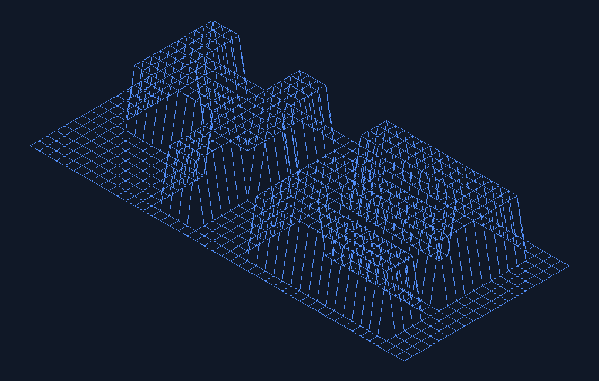

# FdF — каркасная 3D-модель карты высот



## Описание

FdF открывает текстовую карту высот `.fdf` и показывает её в виде каркаса.
Каждое число в файле задаёт высоту точки, а линии соединяют соседние точки сетки.
При открытии карты и изменении размера окна программа подбирает масштаб и центрирует изображение.

## Установка и запуск

Нужен Python 3.12 или новее с `tkinter`. Для запуска приложения достаточно стандартной библиотеки Python.
Откройте терминал в папке проекта, где находится `main.py`.

Команды для Windows PowerShell

```powershell
py -3 --version
py -3 -m venv .venv
.\.venv\Scripts\python.exe main.py maps/42.fdf
```

Команды для Linux и macOS

```bash
python3 --version
python3 -m venv .venv
./.venv/bin/python main.py maps/42.fdf
```

Чтобы открыть другую карту, укажите её путь вместо `maps/42.fdf`.
Например, `maps/flat.fdf` показывает плоскую сетку, а `maps/peak.fdf` — цветную вершину.
Если в пути есть пробелы, заключите его в кавычки.
Проверить доступность графической библиотеки можно командой `python -m tkinter`.

## Управление

| Клавиша или действие | Результат |
| --- | --- |
| Колесо мыши | Изменить масштаб относительно центра окна |
| Стрелки | Сдвинуть карту |
| `+` и `−` | Изменить масштаб высот |
| `T` | Переключить изометрию и вид сверху |
| `Q` и `E` | Повернуть изометрию |
| `R` | Вернуть исходный вид |
| `Esc` или закрытие окна | Выйти из программы |

## Формат карты

Строка файла задаёт ряд точек, а положение значения в строке задаёт колонку.
В каждом ряду должно быть одинаковое количество значений, разделённых пробелами.
Высоты записываются целыми числами и могут быть отрицательными.
Пустые строки в конце файла пропускаются.

После высоты через запятую можно указать цвет `0xRRGGBB`. Допускаются от одной до шести шестнадцатеричных цифр произвольного регистра.
Например, `0xff` задаёт синий цвет `#0000FF`. Для точек без цвета программа подбирает цвет по высоте.
Если цвета концов ребра различаются, вдоль ребра строится градиент.

```text
0 0       0
0 5,0xff -2
0 0       0
```

Если карту прочитать не удаётся, программа выводит причину в `stderr` и завершает работу с кодом `1`.
При неверном числе аргументов код завершения равен `2`.

## Структура проекта

| Путь | Назначение |
| --- | --- |
| `main.py` | Разбор аргумента командной строки и сообщения об ошибках |
| `fdf/errors.py` | Исключения и диагностика формата |
| `fdf/parser.py` | Чтение файла и проверка значений |
| `fdf/model.py` | Точки, прямоугольная сетка и поиск соседей |
| `fdf/projection.py` | Проекция, камера и интерполяция цветов |
| `fdf/app.py` | Окно `tkinter`, отрисовка и обработка ввода |
| `maps/` | Демонстрационные карты и примеры ошибок формата |
| `tests/` | Тесты парсера, модели и проекции |
| `docs/screenshot.png` | Снимок окна приложения |

## Тесты

Установите инструменты разработки в виртуальное окружение.

```powershell
.\.venv\Scripts\python.exe -m pip install -r requirements-dev.txt
```

Для Linux или macOS используйте `./.venv/bin/python` вместо `.\.venv\Scripts\python.exe`.
Команды для проверки из активированного окружения

```bash
pytest -q
mypy --strict fdf main.py
ruff check .
```

Можно запускать те же инструменты через Python окружения, например `.\.venv\Scripts\python.exe -m pytest -q`.
GitHub Actions запускает эти проверки при `push` и `pull request`.

## Лицензия

Проект распространяется по лицензии MIT. [Текст лицензии](LICENSE).
